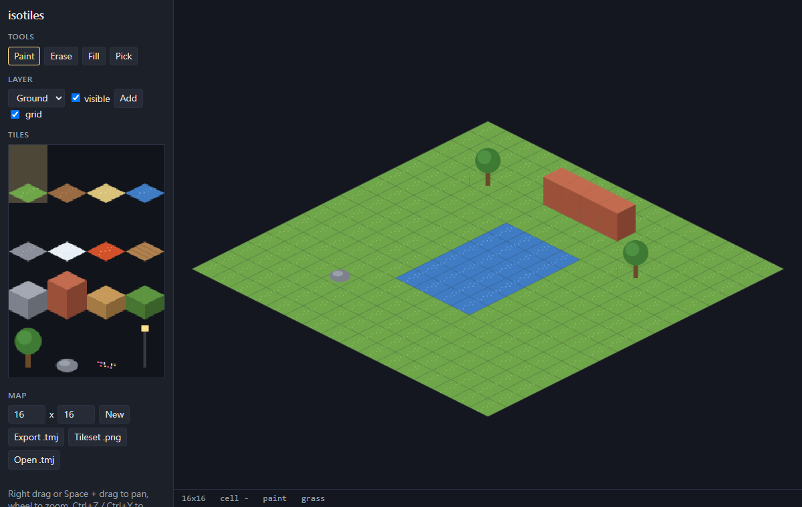
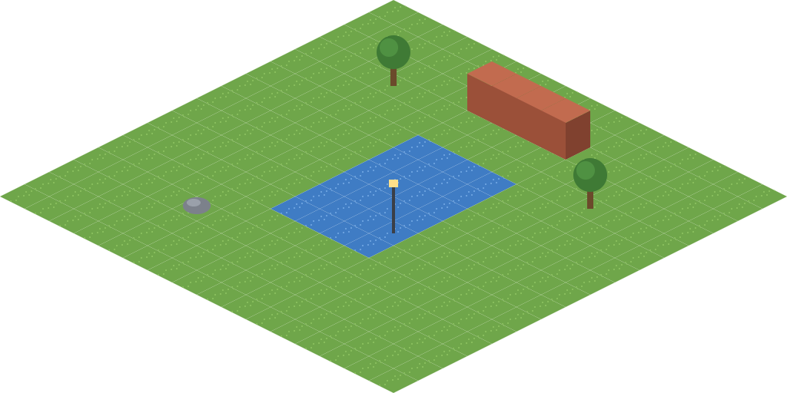

# isotiles

[English](README.en.md)

在瀏覽器畫 45 度俯角（等角）地圖，存成 Tiled 的 .tmj，Tiled 和支援 Tiled 的引擎可以直接開。

線上使用：https://vtxe02023274.github.io/isotiles/



同一張圖匯出後用 Tiled 的 `tmxrasterizer` 畫出來，位置和遮擋順序一樣：



## 功能

- 畫筆、橡皮擦、油漆桶、矩形、滴管，拖曳一筆可以一次復原
- 多圖層，可隱藏
- 內建 16 種圖塊（地面、方塊、樹、路燈），全部用程式畫，沒有第三方素材
- 比格子高的圖塊（牆、樹）底部貼齊格子下緣，跟 Tiled 的畫法一樣
- 匯出整張地圖 PNG
- 匯出 .tmj ＋ tileset PNG；匯入 Tiled 存的等角地圖 .tmj 或 .tmx（CSV、base64、zlib、gzip 圖層，單一圖片 tileset，支援 tileoffset 和群組），Tiled 自帶的 `isometric_grass_and_water.tmx` 可以直接開
- 瀏覽器會自動存目前的地圖

| 操作                             | 按鍵                     |
| -------------------------------- | ------------------------ |
| 畫筆／橡皮擦／油漆桶／矩形／滴管 | B／E／F／R／I            |
| 平移                             | 右鍵拖曳，或 Space＋拖曳 |
| 縮放                             | 滾輪                     |
| 復原／重做                       | Ctrl+Z／Ctrl+Y           |

## 在 Tiled 開啟

1. 按「Export .tmj」和「Tileset .png」，兩個檔放在同一個資料夾
2. 用 Tiled 開 map.tmj

用自己的 tileset：在 Tiled 做一張等角地圖、tileset 用單張圖片、圖層格式選 CSV，存成 .tmj。按「Open .tmj」時把 .tmj 和圖片一起選。

## 座標

跟 Tiled 一樣，(0, 0) 在最上面，x 往右下、y 往左下。點擊判斷用菱形本身，不是外框矩形，邊緣附近也不會點到隔壁格。轉換公式在 `src/iso.ts`。

## 開發

```sh
npm install
npm run dev     # http://localhost:5190
npm test
npm run lint
```

## 授權

MIT
